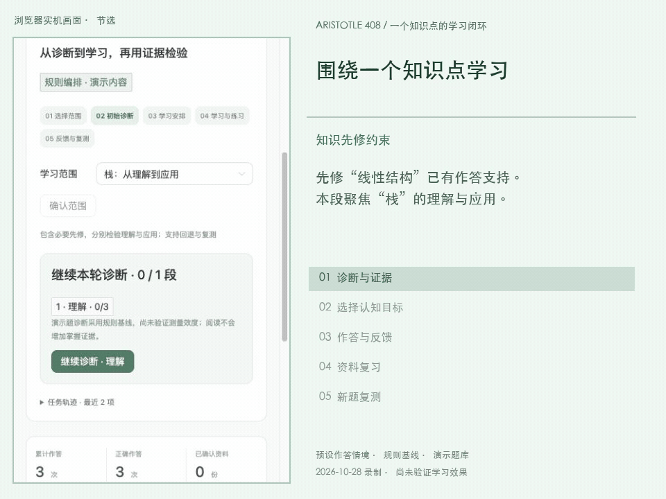

# Aristotle 408

面向计算机 408 备考大学生的自适应学习 Agent，帮助学生明确「哪些知识还没掌握，下一步应该学什么、练习什么认知活动」。

本项目是[智能软件工程实践课程](https://github.com/bettermorn/IntelligentSWEPractice)的小组实践作品。目前已有需求分析稿、后端 API 原型，以及已接入 API 的 Vue 学习端，范围选择、分段诊断、学习安排、资料复习/练习、反馈复测、导入确认、标注审核和内容纠错已连接到持久化后端；尚未完成完整需求验收或学生试用。以下首版功能仍为产品规划，实际原型范围见各模块说明。

## 实机演示：围绕“栈”的学习闭环

约 **66 秒**，展示当前原型从理解诊断、应用练习到资料复习和新题复测的实际操作。左侧为真实页面，右侧为对应概念说明；演示使用预设作答，部分等待与重复操作经过剪辑。

[](docs/media/stack-learning-flow.mp4)

[观看清晰版 MP4](docs/media/stack-learning-flow.mp4) · [录制情境与验证记录](docs/media/README.md)

| 教育学概念 | 在这段流程中的作用 |
| --- | --- |
| **布鲁姆认知过程维度** | 理解题已有支持、应用证据不足时，选取推演操作的应用任务；标签用于目标与选题，不直接作为学生能力等级。 |
| **知识空间的先修约束思路** | 先修“线性结构”已有证据，再安排“栈”的学习；当前采用先修图规则基线。 |
| **基于多题证据的诊断** | 答对一道题仍显示证据不足；理解、应用分别统计，未覆盖的维度保留不确定性。 |
| **形成性评价的反馈调整思路** | 作答暴露困难 → 提供解析与资料复习 → 用另一组题重新收集证据；阅读完成不直接增加掌握分数。 |

演示题与作答结果用于说明系统行为。诊断阈值仍是初始参数，真实模型标注/PDF 处理保留 mock 或接口占位，诊断效度和学习效果仍待正式评测。

## 产品定位

408 备考覆盖数据结构、计算机组成原理、操作系统和计算机网络。针对薄弱点不清、复习路径固定、个人讲义与练习脱节的问题，Aristotle 408 计划结合知识空间理论诊断掌握状态，利用 LLM 为题目提出布鲁姆认知标签，经人工审核后用于自适应推荐、短关卡目标和学习反馈。产品的重点是让学习路径随作答证据持续调整，帮助学生从概念理解走向应用与分析。

首批计划邀请 **30—50 名学生**试用，首版暂定于 **2026 年 12 月**发布，具体范围与日期随课程排期和开发进度调整。完整背景、5W1H 分析和评估方式见[问题定义与产品描述](docs/requirements/problem_definition.md)。

## 需求文档

| 文档 | 内容 |
| --- | --- |
| [问题定义与产品描述](docs/requirements/problem_definition.md) | 目标用户、痛点、方案、评估方式与交付计划 |
| [功能需求规范](docs/requirements/functional_spec.md) | 系统角色、功能分解、LLM 认知标签规则、用例验收与领域模型 |
| [非功能需求规范](docs/requirements/nonfunctional_spec.md) | URPS、安全隐私、标签质量与可测量的验收目标 |
| [后端技术方案](docs/software/backend_technical_proposal.md) | 技术选择、架构、数据模型、事务与原型边界，待团队评审 |
| [后端 API 约定](docs/software/backend_api.md) | 前端联调接口、错误与幂等约定 |
| [规则基线](docs/algorithm/baseline.md) | 证据窗口、先修约束与选题逻辑 |
| [后端原型验证](docs/software/backend_validation.md) | 本地检查证据与未验证范围 |
| [原设计对齐流程](docs/software/design_aligned_workflow.md) | 完整流程、真实/mock/占位边界、API 和启动方式 |
| [前后端联调记录](docs/software/frontend_backend_integration.md) | 对接范围、启动方式、自动化与浏览器验证 |

两份需求规范对应 [issue #5](https://github.com/AbracaSora/Aristotle/issues/5)，并纳入 [issue #6](https://github.com/AbracaSora/Aristotle/issues/6) 的认知标签建议。目前为待课程评审的需求分析稿，指标是设计目标，尚无功能或学习效果验证结果。

## 首版规划

先以**数据结构的部分章节**验证完整学习流程，再逐步扩展至其他科目；具体章节在需求分析阶段确定。

| 能力 | 首版计划 |
| --- | --- |
| 知识诊断 | 结合知识点、先修关系和多次作答，估计掌握状态与薄弱点 |
| 题目认知标签 | LLM 结合题干、答案和解析提出布鲁姆标签与理由，人工审核后发布并保留版本 |
| 自适应推荐 | 根据知识状态、先修约束和各认知维度的作答证据推荐任务，说明知识点、认知目标与推荐理由 |
| 个人资料 | 支持文本型 PDF 或粘贴讲义，将内容关联到预设知识点，保留来源位置 |
| 短关卡学习 | 按认知目标组织 3—5 道已审核客观题，展示标签解释、判分和巩固或提升建议 |
| 学习记录 | 保存作答与进度，展示知识点及认知维度的证据，在后续学习中更新诊断和推荐 |

内容准备：**知识点与题目录入 → LLM 候选认知标注 → 人工核验答案、解析和标签 → 发布题库**。

学习流程：**选择范围或上传讲义 → 初始诊断 → 推荐知识点与认知目标 → 关卡学习与反馈 → 更新知识状态及认知维度证据 → 下一轮复习**。不上传个人讲义也能使用公共题库学习。

首版重点覆盖**记忆、理解、应用、分析**四类认知目标；完整分类保留“评价、创造”，相关开放活动及人工评价作为后续增强。首版暂不覆盖全部 408 题型、扫描件识别、复杂主观题自动评分和社交排行榜。

## 自适应学习思路

- **知识空间**：依据知识点及先修关系约束可能的掌握状态，识别当前状态下适合继续学习的内容；不将一次答错直接等同于未掌握。
- **布鲁姆标签**：描述题目要求的认知活动，不等于难度或学生实际能力。不仅展示标签，还用于设置关卡目标、筛选题目和生成下一步建议；不能凭一次答对就认定学生达到某级认知能力。
- **推荐策略**：先实现可解释的规则基线，综合知识缺口、先修条件、认知维度证据与复习记录安排任务；允许补测、回退巩固，不要求所有知识点机械地按六级升级。
- **Agent 职责**：调用资料检索、认知标注、诊断和推荐工具，组织任务并生成解释；判分、状态存储、内容发布和策略约束由程序执行。模型置信度只供审核参考；未审核标签不得用于学生任务。模型不可用时仍可练习已审核题目并查看静态解析与规则建议。

使用独立测评题检查诊断效果，并记录薄弱点前后测表现、关卡完成情况与用户反馈；另用双人独立标注、分歧裁定后的题集评测 LLM 标签质量。两类评估分开进行：标签一致率高不代表学习收益已成立，关卡进度也不代表掌握程度。具体口径见非功能需求规范。

## 仓库结构

沿用课程建议的文档、代码、测试分层结构：

```text
.
├── docs/
│   ├── requirements/     # 问题定义、需求规格、用户故事与验收标准
│   ├── algorithm/        # 理论调研、诊断与推荐算法
│   ├── software/         # 原型、系统架构与接口设计
│   ├── mgmt/             # 分工、沟通与风险管理
│   └── retrospection/    # 迭代复盘
├── code/
│   ├── frontend/         # 学习界面与交互
│   ├── backend/          # API、资料处理与数据存储
│   └── core_engine/      # 可独立测试的诊断与推荐逻辑
└── tests/
    ├── unit/             # 单元测试
    └── integration/      # 集成测试
```

## 开发里程碑

以下周次对应课程的 17 周安排，具体日历日期以课程进度为准。

| 阶段 | 课程周次 | 主要交付 |
| --- | --- | --- |
| 分析 | 第 1—2 周 | 用户调研、问题定义、功能与非功能需求 |
| 设计 | 第 3—6 周 | 评审领域模型与功能分解，设计认知标注规则、交互原型、技术方案及沟通和风险计划 |
| 开发 | 第 7—10 周 | 资料处理、LLM 标注与审核、诊断、推荐及短关卡反馈的完整流程，代码质量检查 |
| 测试 | 第 11—13 周 | 单元与集成测试、标签与内容质量评测、URPS 检查、小组交叉测试及缺陷修复 |
| 发布与迭代 | 第 14—17 周 | 部署、试用反馈、迭代复盘与作品答辩 |

## 团队协作与开发说明

团队拟按前端体验、后端服务、学习引擎、测试与集成划分工作，具体负责人待在项目管理文档中确认。协作约定为使用 Issue 跟踪任务，通过分支和 Pull Request 提交变更，经评审后合并；功能变更同步更新相关文档和测试。

学习端启动见 [前端说明](code/frontend/README.md)。后端启动、演示账号与 API 工作台见 [后端说明](code/backend/README.md)。开发时分别启动后端和 Vite，前端通过代理调用 API，判分与业务数据由服务端处理。

后端原型覆盖账号隔离、规则诊断和选题、持久化作答、文字资料及人工审核流程；真实 LLM/PDF 尚未接入，演示题不代表正式审核题库。开发中使用脱敏或获授权的样例资料，个人讲义、数据库、账号密钥及模型 API 凭据不提交到仓库。
