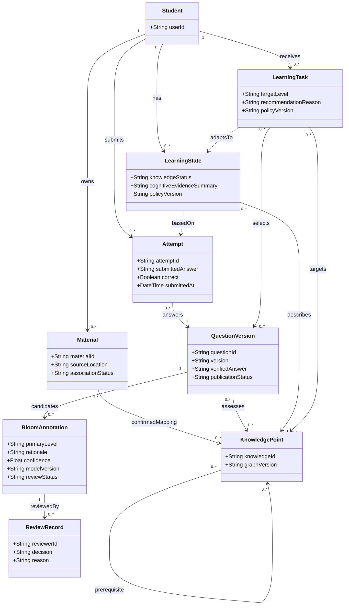

# Aristotle 408 功能需求规范

## 1. 文档目的与范围

| 项目 | 说明 |
| --- | --- |
| 版本 / 日期 | v0.1 / 2026-10-16 |
| 状态 | 需求分析稿，供课程评审与后续实现使用；不代表功能已实现或教师已确认 |
| 交付依据 | [issue #5：提交功能和非功能需求规范](https://github.com/AbracaSora/Aristotle/issues/5) |
| 关联建议 | [issue #6：在学习设计和反馈中使用布鲁姆认知标签](https://github.com/AbracaSora/Aristotle/issues/6) |
| 配套文档 | [问题定义](problem_definition.md)、[非功能需求规范](nonfunctional_spec.md) |
| 编号 / 优先级 | FR 为功能需求，AC 为验收场景；P0 为首版必需，P1 为后续增强 |

面向备考计算机 408 的大学生，首版以**数据结构的部分章节**实现“诊断—推荐—练习—反馈—更新”的学习闭环。章节及题库清单在课程评审后冻结；覆盖全部 408 科目、扫描件 OCR、复杂主观题自动评分、社交排行榜不在首版范围内。首版采用有核验答案的客观题，不依赖实时生成新题才能完成学习。

LLM 为题目给出布鲁姆认知标签和理由，经审核后用于学习目标、选题与反馈。知识空间约束“哪些知识可以继续学”，认知标签描述“题目要求进行什么思维活动”；二者共同服务推荐，但不能互相替代。

## 2. 系统角色与职责

| 角色 | 输入与职责 | 权限边界 |
| --- | --- | --- |
| 学生 | 选择学习范围、上传个人讲义、完成诊断与练习、查看建议、报告内容问题 | 仅访问本人的资料、作答和学习状态，以及已发布的公共题目 |
| 内容维护者（首版由团队成员承担） | 维护知识点和先修关系；录入题目、答案和解析；审核或纠正 LLM 标签 | 维护公共学习内容，不因该角色自动获得学生私人资料访问权 |
| 系统管理员（首版可由团队成员兼任） | 配置模型、调用限额、用户角色，处理故障与备份恢复 | 管理操作需记录；密钥不暴露给学生或模型上下文 |
| 外部 LLM 服务 | 根据题目、答案、解析和标注规则返回候选标签与解释；辅助组织学习反馈 | 不直接判分、修改掌握状态、发布题目或绕过权限与推荐约束 |

学习 Agent 是系统内部的任务组织者：调用资料检索、诊断、推荐和反馈工具。首版不要求多智能体架构，判分、状态写入、内容发布和规则校验由确定性程序负责。

## 3. 功能树与需求条目

下列每行是一项可追踪的需求；除标注 P1 的 FR-8.1 外均为 P0。

### 3.1 学习身份与范围

| 编号 | 输入、行为与输出 | 验收标准 |
| --- | --- | --- |
| FR-1.1 | 学生登录分配的试用账号后，系统绑定独立的资料、作答和进度；退出后要求重新认证 | 两个账号不能读写对方资料和学习记录；重新登录可读取自己的已保存进度 |
| FR-1.2 | 学生从已发布的章节中选择学习范围；可以不上传讲义而使用公共内容 | 未覆盖的章节明确标为暂不支持；改变范围不删除原有历史；无个人资料也能完成 AC-01 |

### 3.2 知识与个人资料

| 编号 | 输入、行为与输出 | 验收标准 |
| --- | --- | --- |
| FR-2.1 | 内容维护者维护知识点、章节归属与先修关系，发布带版本的知识结构 | 拒绝不存在的知识点引用、自环与先修环路；非法变更不影响已发布版本 |
| FR-2.2 | 学生上传文本型 PDF 或粘贴讲义；系统提取文本，关联已有知识点并保留页码或段落来源 | 限制为每份 PDF 不超过 20 MB 且不超过 100 页、粘贴文本不超过 2 万字符；空文本、扫描件、加密文件及超限输入给出具体原因且不进入推荐 |
| FR-2.3 | 系统展示候选资料片段及知识点关联；学生可确认、取消或纠正关联 | 无法可靠关联时保持“待确认”；只有已确认关联可用于个人推荐；学生资料不能自动改写公共知识结构 |
| FR-2.4 | 学生删除个人资料后，系统停止检索该资料及其派生片段 | 删除后新推荐和反馈不再引用该资料；历史中显示“来源已删除”，不再展示原文；备份清理按 NFR-SEC-02 执行 |

### 3.3 题目与 LLM 认知标注

| 编号 | 输入、行为与输出 | 验收标准 |
| --- | --- | --- |
| FR-3.1 | 内容维护者录入题干、选项、标准答案、解析、知识点与合法来源，形成题目版本 | 缺少必填项、答案不属于选项或知识点不存在时拒绝发布；首版学习题目均有人工核验答案 |
| FR-3.2 | LLM 读取题目完整内容、标准答案、解析及第 4 节标注规则，输出主认知标签、可选次标签、理由和置信度 | 输出通过第 4.2 节字段与枚举校验；空理由、非法标签、超出范围的置信度或非结构化输出不得直接入库为有效标签 |
| FR-3.3 | 内容维护者查看模型候选、理由和题目，可批准、修改或驳回；保留原候选和审核记录 | 所有模型候选首版均需人工审核；低置信度（默认低于 0.8）或含歧义的候选重点提示；未审核或已驳回题目不得进入学生任务 |
| FR-3.4 | 发布前校验答案、解析与标签，保存题目、标注规则、模型及审核版本 | 修改题干、选项、答案或解析后，旧标签不得直接用于新版本；需重新标注审核；历史作答仍引用当时版本 |

### 3.4 初始诊断与学习状态

| 编号 | 输入、行为与输出 | 验收标准 |
| --- | --- | --- |
| FR-4.1 | 系统按所选范围，从已发布题库抽取诊断题，结合先修关系估计知识点状态 | 输出“证据不足 / 待巩固 / 初步掌握”及对应证据；缺题时说明无法诊断的范围，不伪造结果 |
| FR-4.2 | 根据多次作答和知识先修关系更新知识状态，并按“知识点 × 认知标签”记录表现 | 单次答对不能直接确认为掌握，单次答错不能直接判定未掌握；重复提交同一作答不增加证据；跨认知维度不直接外推 |

首版可解释基线：同一知识点在本轮诊断或最近 14 天内有至少 3 道不同题目的有效作答后，才给出“待巩固”或“初步掌握”；正确率达到 80% 且先修知识点均为“初步掌握”时给出“初步掌握”，否则为“待巩固”。未达到证据量时为“证据不足”。阈值为初始设计参数，可在试用后调整并记录策略版本，不宣称其已具备经验证的测量效度。

认知维度分别显示题目数量、正确率与最近作答时间；不足 3 道不同题目时标记“证据不足”。该展示是练习表现摘要，不输出“学生总体达到布鲁姆第几级”的结论。同题反复练习保留历史，但上述窗口内仅以该题首次有效作答计入诊断证据；后续掌握变化通过其他题目或新一轮独立诊断观察。

### 3.5 自适应任务与认知目标

| 编号 | 输入、行为与输出 | 验收标准 |
| --- | --- | --- |
| FR-5.1 | 结合知识状态、先修约束、认知表现与复习记录，输出可执行的下一学习任务 | 推荐包含目标知识点、目标认知活动、资料或题目、推荐理由；先修不足时优先补足先修；待审核题目、越权资料不能成为候选 |
| FR-5.2 | 为短关卡配置知识目标、主认知目标与 3—5 道题，题目卡片展示认知标签及通俗解释 | 不仅展示标签，还能按目标筛选题目；库存不足时缩短并说明或退回资料复习，不用其他标签伪装目标已覆盖 |
| FR-5.3 | 针对认知表现给出巩固或提升建议，学生可接受、跳过或更换任务 | 例如“栈的概念题证据较充分，下一步练习给定序列的出栈判断（应用）”；应用题连续出错时可回到理解任务；不强迫所有知识点按六级逐级通关 |

推荐顺序采用规则基线：先满足先修与内容审核约束，再优先处理待巩固点、补充证据不足点，最后推荐已掌握点的进一步应用或复习；同优先级优先选最近未练的题。每次推荐记录策略版本和选择依据。LLM 可以解释推荐，但不得改变程序选定的候选集合与目标。待巩固点没有可用题时，展示相关已确认资料或明确提示内容不足。

### 3.6 作答、反馈与记录

| 编号 | 输入、行为与输出 | 验收标准 |
| --- | --- | --- |
| FR-6.1 | 学生提交选项；程序按当前题目版本的标准答案判分并保存作答 | 相同题目版本和选项得到相同判分；首次提交成功才更新状态；重试不重复计分；提交前不显示标准答案与解析 |
| FR-6.2 | 提交后展示正确答案、解析、题目认知标签及有依据的下一步建议；LLM 可辅助表述 | 反馈明确“本题考查应用”等任务要求；建议关联具体知识点和任务；证据不足时明确说明，不凭一题宣称认知水平提升；模型失败时仍能展示已审核解析与规则建议 |
| FR-6.3 | 学生查看关卡历史、知识状态及各认知维度表现，可报告答案或标签问题 | 反馈可追溯至题目版本、作答与策略版本；被维护者停用的题目不再分配；其历史作答保留并标记，诊断重算时排除被判无效的证据 |

### 3.7 管理与外部服务

| 编号 | 输入、行为与输出 | 验收标准 |
| --- | --- | --- |
| FR-7.1 | 管理员配置 LLM 服务、模型、超时、重试、限额；记录任务状态与用量 | 超时、限流或输出校验失败时按 NFR-R-02 降级；失败任务可人工重试且不重复发布内容；密钥不进入前端 |
| FR-7.2 | 记录题目发布、标签修订、策略变更与角色变更的操作者、时间和版本 | 可从一条历史推荐定位当时的内容和策略；未经授权的操作被拒绝并记录 |

### 3.8 后续增强

| 编号 | 优先级 | 内容与进入条件 |
| --- | --- | --- |
| FR-8.1 | P1 | 扩展“评价、创造”学习活动及开放题人工评价；须先补齐活动设计、评分量规和人工反馈流程，再另行评审。首版不承诺自动评分或认知等级认证 |

## 4. 布鲁姆认知标签规范

### 4.1 分类口径与边界

采用修订版布鲁姆教育目标分类的认知过程维度。首版重点覆盖“记忆、理解、应用、分析”，完整词表保留“评价、创造”用于标注与未来设计；后两类不纳入首版自动推荐任务。内容审核时须明确题目实际要求的思维活动，而非仅根据题干动词或知识点名称判断。

| 标签 / 枚举 | 含义 | 数据结构任务示例 |
| --- | --- | --- |
| 记忆 / remember | 提取或识别已学事实 | 识别栈“后进先出”的定义 |
| 理解 / understand | 解释含义、分类或举例 | 解释为什么函数调用可借助栈保存返回位置 |
| 应用 / apply | 在给定情境中执行已学方法 | 根据给定操作序列计算栈中元素或出栈顺序 |
| 分析 / analyze | 分解结构并辨别关系、成因 | 比较两段栈算法，定位导致顺序错误的步骤与原因 |
| 评价 / evaluate | 依据明确准则作判断并论证 | 按时间、空间和使用约束评价两种存储方案 |
| 创造 / create | 组合知识形成新方案 | 为新约束设计数据结构和算法并说明方案 |

示例仅帮助理解分类，不是已审核题库。题型本身不能决定标签；如果选择题只要求识别一个给出的方案，不能因题干出现“设计”就标成创造。认知标签不等于题目难度，标签更高也不代表题目必然更难。一个任务可以涉及多种过程，主标签应反映其主要且必要的认知要求，次标签补充其他要求；不机械选择出现过的最高等级。

### 4.2 标注输入、输出与审核

模型输入包含题目 ID 与版本、题干、选项、标准答案、解析、知识点、分类规则及规则版本。只提供完成标注所需的题目内容，不附带学生身份和私人讲义。

| 字段 | 规则 |
| --- | --- |
| question_id / question_version | 必须与本次任务的题目一致，禁止把旧输出写入新版本 |
| primary_level | 第 4.1 节六种英文枚举之一，只能有一个 |
| secondary_levels | 同一词表中的零个或多个不重复标签，不含主标签 |
| rationale | 非空文字，引用具体解题步骤说明分类依据；不是仅复述题干动词 |
| confidence | 0—1 的模型自报置信度，仅作审核排序参考，不作为正确概率或自动放行依据 |
| ambiguity_note | 可为空；信息不足或多种分类均合理时说明原因并转人工 |

系统另外保存模型标识、提示模板版本、规则版本、调用时间、任务 ID、审核状态、审核人、审核理由、最终标签和审核时间。LLM 不得自行填写“已审核”状态。状态流为“待标注 → 待审核 → 已批准 / 已驳回”；内容发布还需通过答案与解析审核。调用失败保持待标注并记录错误；修改题目产生新版本并重新进入待标注。已发布版本只读，修订产生新版本；原版本可停用。

### 4.3 贯穿学习设计与反馈的示例

学生在“栈”的概念理解题上已有多题支持，但给定操作序列的应用题表现不足。系统为其安排“应用栈操作规则”的短关卡，说明依据是已完成的理解题和应用题记录；每道题显示“应用：按规则推演序列”。提交后，程序判分，反馈指出需要复习的入栈/出栈步骤，再推荐同目标的另一道题；证据不足时先补测，连续困难时返回理解材料。这一流程使用的是个人作答证据，不能仅因为系统给题目贴了“分析”标签就声称学生具备分析能力。

## 5. 典型用例与异常验收

| 场景 | 前置条件与操作 | 可观察的通过条件 | 对应需求 |
| --- | --- | --- | --- |
| AC-01 首次学习 | 已发布部分数据结构题库；学生登录、选择范围、不上传讲义，完成诊断与一关练习 | 能看到知识状态、认知目标、题目标签、判分和下一任务；重新登录进度仍在 | FR-1.1、FR-1.2、FR-4.1、FR-5.1、FR-5.2、FR-6.1、FR-6.2 |
| AC-02 个人讲义 | 上传有效文本型 PDF，确认知识点关联，再请求推荐 | 引用可定位到原页；未经确认内容不进入推荐；删除资料后停止新引用 | FR-2.2、FR-2.3、FR-2.4 |
| AC-03 标注与修订 | 录入完整题目，调用 LLM，审核发布；随后修改题干 | 审核前不可选题；发布后可按目标选题；修改后新版本重新标注，旧作答引用不被覆盖 | FR-3.1、FR-3.2、FR-3.3、FR-3.4 |
| AC-04 认知建议 | 准备同知识点理解表现较充分、应用表现不足的作答记录 | 推荐应用任务并解释证据；先修不足时先补先修；仅一题时显示证据不足 | FR-4.2、FR-5.1、FR-5.3、FR-6.2 |
| AC-05 内容不足 | 所选知识点无已批准的目标标签题目，或模型仅返回评价/创造候选 | 告知未覆盖，安排已确认资料或其他明确标示的目标；不伪造题目或静默更换标签 | FR-4.1、FR-5.2、FR-8.1 |
| AC-06 外部失败 | 注入超时、限流、非法标签和旧题版本结果 | 错误候选均不发布；已审核题目可继续练习并显示静态解析与规则建议 | FR-3.2、FR-3.3、FR-7.1 |
| AC-07 重试与越权 | 重复提交同一作答，使用另一账号请求资料，尝试学生角色发布题目 | 作答仅计一次；跨用户访问和越权发布均被拒绝 | FR-1.1、FR-6.1、FR-7.2 |
| AC-08 内容纠错 | 学生报告错题，维护者确认问题并停用题目 | 不再分配该题；历史标记原因；重算状态时不使用无效证据 | FR-6.3、FR-7.2 |
| AC-09 知识结构维护 | 尝试发布自环、环路或悬空引用，再发布合法结构 | 非法版本被拒绝且不影响现有推荐；合法版本可追踪 | FR-2.1 |

## 6. 领域模型（UML）

领域模型用于说明业务概念，尚非数据库表设计。已发布题目版本只能关联一份生效的最终认知标注；其他候选及审核记录用于追踪。学习任务可为纯资料复习，因此允许零道题。先修关系的无环约束由 FR-2.1 保证。

## 7. 评审与后续交付

- 本文与非功能需求规范共同响应 issue #5；issue #6 的建议已纳入需求，但功能实现与学习效果尚待开发和验证。
- 按课程安排，在教师确认领域模型和功能分解后进入系统原型设计；章节清单、题库来源、诊断阈值和认知活动样例在评审中确认。
- 后续将 AC 场景落成单元与集成测试；标签质量和试用收益按非功能需求规范分别评估，不以文档检查代替软件验收。

## 8. 参考资料

- [课程：第 2 周实践——软件功能规范书撰写](https://github.com/bettermorn/IntelligentSWEPractice/blob/main/courseware/pages/part1analyze.md#第-2-周实践软件功能规范书撰写)
- [课程示例：多智能体 AI Agent 工业分析平台软件功能规格说明书](https://github.com/bettermorn/AIAgent/blob/main/docs/AIAgentFunSpec.md)
- Anderson, L. W., & Krathwohl, D. R. (Eds.). (2001). *A Taxonomy for Learning, Teaching, and Assessing: A Revision of Bloom's Taxonomy of Educational Objectives*. 本项目采用其中的认知过程维度，不将其直接当作心理测量量表。
