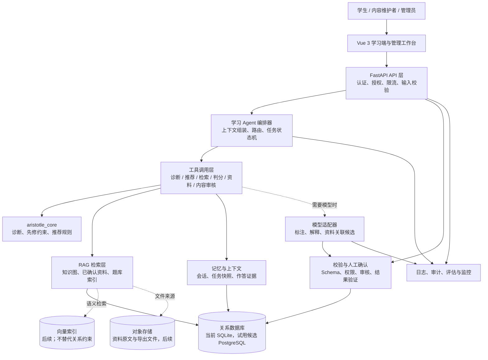
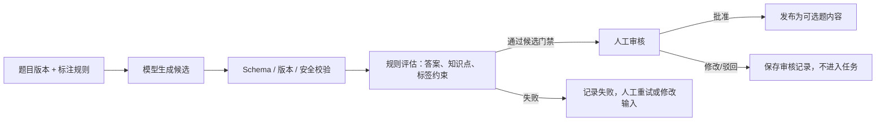
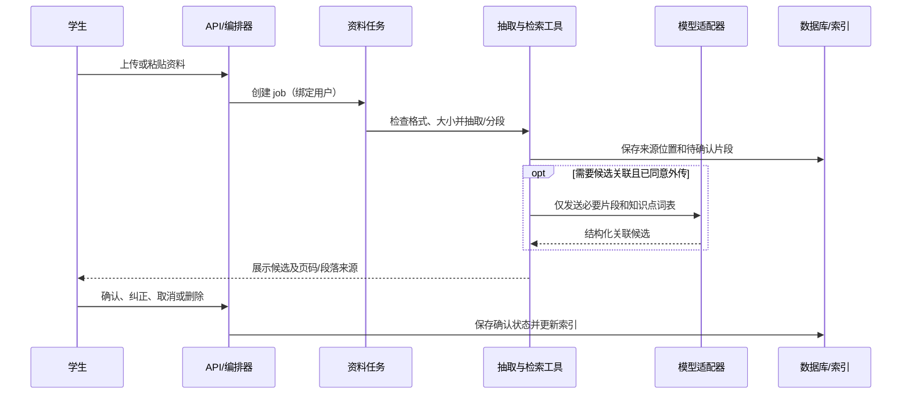

# Aristotle 408 技术架构

版本：v0.1，2026-11-05。状态：面向评审的架构设计；当前原型已实现的范围以[后端技术方案](backend_technical_proposal.md)和[原设计对齐流程](design_aligned_workflow.md)为准。

本文参考 [AI Agent 常见工作流模式](https://github.com/bettermorn/AIAgent/blob/main/docs/AIAgentConcept.md#常见agent工作流模式)，并结合 Aristotle 408 的实际需求设计。参考资料中的架构图和技术栈是通用示例，不是本项目必须采用的实现指令；本项目优先遵守已有需求、接口和安全边界。

## 1. 架构目标与约束

Aristotle 408 的核心是“诊断—推荐—学习—反馈—更新”的可追踪闭环。Agent 负责理解任务、组织上下文、调用工具和生成解释；确定性程序负责判分、先修约束、状态写入、权限控制和内容发布。这样即使模型不可用，已审核题库仍能支持学习。

架构遵循以下约束：

- **程序掌握业务不变量**：模型不能直接修改掌握状态、发布题目、绕过先修关系或读取其他学生资料。
- **版本可追溯**：任务、诊断和反馈同时保存知识图、题目、策略、提示模板和模型版本；新内容通过新版本发布。
- **状态与证据分离**：作答是原始证据，知识状态和推荐是可重算的派生结果；阅读资料不直接增加作答证据。
- **隐私最小化**：个人资料按用户隔离，发送给外部模型前需要同意，只传完成任务所需的片段。
- **渐进式演进**：首版采用模块化单体和同步规则引擎；在负载和质量评估证明需要后，再拆分 worker、队列、向量检索或独立模型网关。

## 2. 总体架构



### 2.1 分层职责与技术选择

| 层 | 主要职责 | 首版实现 | 演进方向 |
| --- | --- | --- | --- |
| 交互层 | 登录、范围选择、诊断、任务、作答、资料和管理页面 | Vue 3 + Vite；前端不自行判分或写学习状态 | 移动端或其他客户端复用同一 API |
| API / 访问层 | HTTP 契约、Bearer 会话、角色权限、限流、错误和 OpenAPI | FastAPI + Pydantic；路由位于 `code/backend/aristotle_backend` | 按 auth、learning、materials、content 拆分路由；网关和 HTTPS 在部署层实现 |
| Agent 编排层 | 组装上下文、选择工作流、调用工具、推进任务状态、生成解释 | Python 模块化工作流；以显式状态机和服务函数实现，不依赖实时 LLM 才能运行 | 可用 LangGraph 等状态图框架承载长任务，但不改变工具权限与版本约束 |
| 模型层 | 认知标签候选、资料关联候选、自然语言反馈 | 当前为 mock/占位适配器；模型失败时走规则和静态解析 | OpenAI、Claude、Gemini 等通过统一 `ModelProvider` 接口接入，记录模型、提示、耗时和用量 |
| 工具层 | 将业务动作封装为窄接口，读写均受权限和版本校验 | 诊断、推荐、判分、资料、标注和审核服务 | 长任务使用数据库 job 表和 worker；外部队列按实际负载再引入 |
| 知识与 RAG 层 | 检索知识点、题目、已确认资料片段并保留来源 | 关系查询和规则筛选；文字资料分段可运行，关联为 mock/人工确认 | 采用 embedding + 向量库召回，再由权限过滤和引用校验；向量检索不直接决定发布或判分 |
| 记忆 / 状态层 | 会话、任务快照、作答、证据窗口、学习状态、时间线 | SQLAlchemy 2.0 + SQLite 文件库 | PostgreSQL、缓存和独立事件/任务存储；派生状态可按策略版本重算 |
| 校验与人审层 | 结构校验、事实/版本/权限检查、审核发布、人工确认 | Pydantic、数据库约束、内容维护者审核 | 评估器、质量抽检和双人标注工作台 |
| 基础设施层 | 部署、密钥、日志、审计、备份和监控 | 本地单进程 Uvicorn；应用审计表和测试日志 | Docker/Kubernetes、集中日志、Prometheus、密钥管理和备份恢复 |

## 3. Agent 工作流模式及本项目映射

参考资料中的五类常见模式并非五个独立 Agent，而是编排器可以组合的控制结构。本项目首版先用确定性代码实现流程，模型只在候选生成和解释等适合生成式任务的位置出现。

### 3.1 Prompt Chaining（提示链 / 顺序流水线）

将一个复杂目标拆成有明确输入输出的连续步骤，每一步的结果作为下一步输入。项目中的典型链路如下：

```text
选择范围 → 初始诊断 → 计算知识状态 → 选择任务 → 作答判分
        → 保存证据 → 生成反馈 → 更新下一步任务
```

资料和内容链路分别为“导入 → 抽取 → 分段 → 候选关联 → 学生确认”和“题目录入 → 模型标注 → 字段校验 → 人工审核 → 发布”。每一步都保存状态，失败时可以从当前 job 重试，不重复发布或重复计分。

### 3.2 Routing（路由）

编排器根据请求类型、用户角色、内容状态和模型可用性选择路径：

| 条件 | 路由 |
| --- | --- |
| 普通学习、已审核题库 | 规则诊断/推荐 + 程序判分；不调用模型 |
| 需要自然语言解释 | 先取得确定性证据，再调用解释模型；模型失败返回静态反馈 |
| 新题认知标注 | 模型候选 → 结构校验 → 人工审核；未审核不进入学生任务 |
| 个人资料检索 | 只检索当前用户已确认且未删除的片段；权限过滤先于模型上下文 |
| 模型超时、限流或输出非法 | 记录失败并转人工/静态路径，不自动放行 |

路由由程序执行，模型不能通过提示词要求自己改变路由、扩大数据范围或跳过审核。

### 3.3 Parallelization（并行化）

可并行的工作必须彼此独立，最终合并仍由确定性校验完成。例如：

- 对不同知识点分别汇总作答证据，再按知识图拓扑顺序计算状态；
- 对一批题目生成候选标签或对多个资料片段生成关联候选；
- 同时读取公共题库和当前用户资料，再按权限、确认状态和目标标签合并。

首版暂不承诺并行执行：当前单进程原型优先保证事务和可复现性。引入并发 worker 时，需用 job 唯一键、版本条件更新和幂等写入，避免同一作答重复计分或同一候选重复发布。

### 3.4 Orchestrator-Workers（编排器—工作器）

编排器理解“下一步学习目标”，把窄任务交给工具或 worker；worker 不能拥有超出接口声明的权限。一个学习任务可抽象为：

```text
编排器：确定目标知识点、认知目标、策略版本和证据摘要
  ├─ diagnostic_tool：读取作答并计算诊断
  ├─ recommendation_tool：按先修和库存选择候选
  ├─ retrieval_tool：读取公共题目或已确认资料
  ├─ grading_tool：按题目版本程序判分并幂等保存
  └─ feedback_tool：基于已验证事实生成解释或静态反馈
```

工具返回结构化结果（状态、版本、来源、错误码），不返回可执行指令。编排器只能组合这些结果，不能直接写数据库表或把模型文本当作业务事实。

### 3.5 Evaluator-Optimizer（评估器—优化器）与人工确认

最适合模型候选的模式是“生成 → 评估 → 修订/人工决定”，而不是“模型生成即发布”：



评估器只能判定候选是否满足技术和业务门禁，不能替代教师或内容维护者对认知标签、答案和解析的最终责任。模型置信度只用于排序，不是自动批准条件。

## 4. 关键运行时流程

### 4.1 学生学习闭环

1. API 验证会话、角色和学习范围，读取当前知识图版本。
2. 编排器调用 `diagnostic_tool`；`aristotle_core` 按 `baseline-0.1` 规则聚合作答证据，少于三道不同题目时返回证据不足。
3. `recommendation_tool` 先过滤先修未满足、未发布题目、越权资料和不匹配认知目标，再按规则选择题目；保存策略版本、选择依据和证据摘要。
4. 学生接受任务后，`grading_tool` 使用题目版本中的标准答案判分。提交键和题目键由数据库唯一约束保证幂等，重试读取首次结果。
5. 反馈层先返回答案、解析、标签和规则依据；需要自然语言润色时才调用模型。模型输出只能作为展示文本，不能覆盖判分或状态。
6. 读取学习状态时按当前有效题目、14 天证据窗口和策略版本重算，确保停用题目、删除资料和规则升级能正确生效。

### 4.2 资料导入与 RAG



未确认的片段不进入推荐；删除资料会立即阻止新检索，并在历史读取时重新校验来源状态。向量索引是召回优化，必须经过用户权限、确认状态、知识点和来源校验。

### 4.3 题目认知标注与发布

题目版本、答案、解析、知识点、提示模板、规则版本和模型版本构成一次可追踪的标注输入。模型返回的 `primary_level`、`secondary_levels`、`rationale`、`confidence` 等字段先经 Pydantic 和业务规则校验，再进入人工审核。题干或答案发生改变时创建新题目版本，旧标签不能复用到新版本。

## 5. 数据、记忆与版本边界

### 5.1 记忆分层

| 记忆类型 | 内容 | 生命周期与权限 |
| --- | --- | --- |
| 会话记忆 | 当前用户、角色、范围和请求追踪 ID | 由服务端 Bearer 会话控制；不把密钥放入上下文 |
| 工作记忆 | 当前任务目标、证据摘要、待执行步骤和工具结果 | 绑定任务；可恢复、可过期；不直接当作长期能力结论 |
| 长期学习记忆 | 作答、诊断状态、资料确认、任务历史和反馈 | 关系数据库持久化；按用户隔离，状态可按策略重算 |
| 内容记忆 | 知识图、题目版本、标注候选、审核和发布记录 | 公共内容由维护者管理；发布版本不可变，修订产生新版本 |

模型上下文只包含完成当前步骤的最小字段，并显式带上 `user_id`、`graph_version`、`question_version`、`policy_version` 和来源 ID。原始私人讲义不复制到普通日志或任务快照。

### 5.2 一致性与幂等

- 作答保存、题目版本检查和判分在同一数据库事务中完成；`(task_id, question_key)` 与 `(user_id, submission_id)` 均有唯一约束。
- 题目发布、标签审核、资料确认和审计记录在同一事务中提交；失败不能产生“已发布但无审核记录”的状态。
- 派生学习状态不作为唯一事实来源；状态更新失败可由作答记录重算，避免部分写入造成不可恢复的不一致。
- 外部模型调用采用超时、一次重试、预算和配额；重试不能重复发布候选或扣除多次业务结果。

## 6. 安全、可靠性与可观测性

### 安全边界

- API 在每个请求校验身份、角色、资源所有者和当前版本；客户端不能指定作答或资料所有者。
- 模型被视为不可信外部服务。题目、资料和模型输出均按数据处理，不能执行其中的指令、SQL 或工具调用。
- 个人资料外传必须有同意；日志只记录追踪 ID、状态、耗时和用量，不记录完整讲义。
- 审计至少覆盖登录撤销、知识图发布、题目/标签审核、资料删除、角色变更、模型配置和越权拒绝。

### 降级策略

| 故障 | 用户可见行为 |
| --- | --- |
| 模型超时、429、5xx 或非法结构 | 标注任务失败/待人工；已审核题库继续诊断、推荐、判分和查看静态解析 |
| 检索或资料索引不可用 | 不引用该资料，保留公共题库路径并说明内容不足 |
| 派生状态重算失败 | 保留原始作答，返回证据暂不可用；后台可重算，不伪造能力结论 |
| 数据库写入失败或幂等冲突 | 不返回提交成功；客户端可复用原 `submission_id` 重试 |

### 可观测性

每次 Agent 运行记录追踪 ID、工作流/策略版本、工具调用序列、成功/失败原因、延迟和模型用量；不记录模型上下文中的私人原文。评估报告需区分规则路径、模型候选质量、系统性能和学习效果，不能用其中一项替代另一项。

## 7. 部署形态与演进路线

### 当前原型

```text
Vue/Vite 前端 → FastAPI/Uvicorn 单进程 → SQLAlchemy → SQLite 文件库
                                  └→ aristotle_core 纯规则模块
```

当前资料任务、模型调用和审核流程有 mock 或占位边界；原型不宣称具备生产级并发、真实 PDF 抽取、真实 LLM 质量或备份能力。

### 试用前目标形态

```text
浏览器 → HTTPS/反向代理 → FastAPI API
                         ├→ 学习编排与规则服务
                         ├→ PostgreSQL（事务数据）
                         ├→ 对象存储（资料）
                         ├→ 任务 worker / 队列（抽取、标注、索引）
                         ├→ 模型网关（超时、配额、审计）
                         └→ 日志、指标、备份和密钥管理
```

演进顺序为：冻结接口和策略版本 → 完成真实 PDF/模型适配及质量评测 → PostgreSQL 迁移与并发测试 → 引入 worker/队列和对象存储 → 完成 HTTPS、备份恢复、限流和监控验收。任何拆分都必须保留当前工具契约、幂等语义和人工审核门禁。

## 8. 架构验收与未决事项

架构实现应至少能映射到以下既有验收场景：AC-01（无讲义完成学习闭环）、AC-02（资料确认和删除隔离）、AC-03（标注审核和题目版本）、AC-04（认知证据驱动推荐）、AC-05（内容不足不伪造）、AC-06（外部服务失败降级）、AC-07（重试和越权）、AC-08（内容纠错停用）、AC-09（知识图约束）。详见[功能需求规范](../requirements/functional_spec.md)。

在进入试用前还需评审：

1. PostgreSQL、对象存储、向量索引和队列的具体供应商及数据保留策略；
2. 真实模型的模型/提示版本、成本配额、个人资料外传同意和区域合规要求；
3. 资料关联的人工确认责任、双人审核范围和标签质量评估集；
4. 任务并发、备份恢复、删除重放和安全测试结果；
5. 是否需要 LangGraph 等编排框架，或继续使用显式 Python 工作流以保持依赖和调试简单。

本文件描述的是可演进的技术边界，不替代功能需求、非功能需求、API 契约或正式验收报告。

## 9. 参考

- [AI Agent 常见工作流模式](https://github.com/bettermorn/AIAgent/blob/main/docs/AIAgentConcept.md#常见agent工作流模式)
- [后端技术方案](backend_technical_proposal.md)
- [原设计对齐流程](design_aligned_workflow.md)
- [功能需求规范](../requirements/functional_spec.md)
- [非功能需求规范](../requirements/nonfunctional_spec.md)
- [规则基线](../algorithm/baseline.md)
