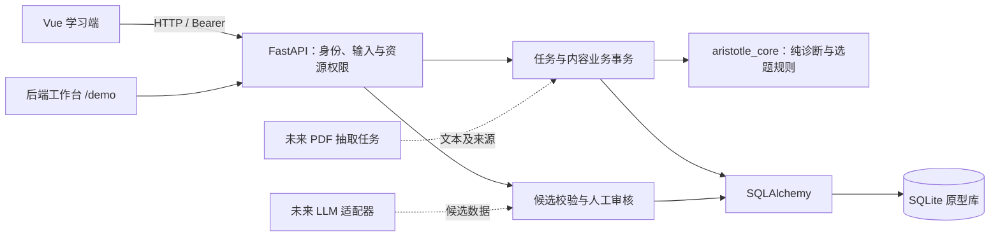

# Aristotle 408 后端技术方案与原型边界

版本：v0.1，2026-10-27。状态：后端组提案与可运行原型，待团队接口评审；不代表教师评审或正式发布验收完成。

2026-10-28 补充：下文 v0.1 范围表保留首轮提案背景。当前已增量实现独立管理员、范围选择、诊断轮次、任务跳过/更换、资料分段确认、内容上报和持久化 mock job；最新状态和可替换边界以 [设计对齐增量方案](design_aligned_workflow.md) 为准，真实模型/PDF、worker、正式评测仍待完成。

## 1. 目标和首轮范围

将功能规范中的“诊断—推荐—作答—反馈—更新”落成可检查的后端流程，同时建立题目审核与个人数据边界。优先支持单一数据结构演示范围，使用规则基线和已发布内容，不依赖实时 LLM 才能学习。

| 本原型实现 | 后续阶段 |
| --- | --- |
| 显式初始化的两名学生及一名维护者，登录与撤销会话 | 正式账号开通、登录限流、管理员独立权限 |
| 不可变知识图快照、先修校验、不可变题目内容版本 | 知识图差异评审、完整章节范围选择 |
| 14 天证据窗口、首次有效作答去重、先修约束、规则选题 | 独立诊断轮次、经验证的知识空间模型与策略比较 |
| 任务快照、服务端判分、幂等保存、历史记录 | 显式跳过/更换任务、内容问题报告与批量纠错 |
| 文字资料录入、手动关联确认、删除后的查询隔离 | PDF 抽取、可靠匹配、分段索引、备份删除机制 |
| 候选字段校验、审核发布、停用与操作审计 | 真实 LLM 调用、预算和超时、队列、质量评测 |

原型的 `/demo` 为后端验收工作台，不替代 Vue 学习端。Vue 已完成第一轮 API 对接，详见 [联调记录](frontend_backend_integration.md)；旧 localStorage 演示数据不自动导入服务端。

## 2. 技术选择

| 决策 | 理由与代价 |
| --- | --- |
| Python 3.12 + FastAPI | 便于后续 PDF/模型工具集成，Pydantic 校验和 OpenAPI 方便前端联调；采用锁文件固定实际版本 |
| 同步 SQLAlchemy 2.0 Session | 请求独立 Session，事务边界清楚，减少原型阶段异步数据库复杂度；对外试用前再做实际并发测量 |
| SQLite 文件库 | 本地无需独立数据库服务，重启能保留数据；只作为单进程原型，不据此承诺试用并发性能 |
| PostgreSQL 为试用候选 | 后续结合部署资源确认，需补驱动、Alembic 迁移、兼容性和并发测试，不承诺只换 URL 即完成迁移 |
| 服务端随机 Bearer 会话 | 令牌仅保存 SHA-256 摘要，可即时退出撤销；密码用随机盐与 PBKDF2-SHA256；原型会话有效期 8 小时 |
| 模块化单体 | HTTP、存储与纯学习规则分离；当前规模无需微服务、Redis 或独立消息平台 |

备选方案：Node/TypeScript 可与前端统一语言，但引擎及资料处理接 Python 工具更直接；Django 适合管理后台较重的系统，此轮优先轻量 API。最终选型需由后端与学习引擎负责人共同确认。

## 3. 模块与数据流

`code/core_engine/aristotle_core/` 不依赖 FastAPI、数据库或模型服务。`code/backend/aristotle_backend/` 管理身份、授权、数据库事务和接口。原型路由集中在 `app.py`，下一轮可在不改变接口的前提下按 auth/learning/materials/content 拆分。

学生作答路径：身份验证 → 检查任务归属和固定题目版本 → 查询幂等结果 → 核查题目仍可作答 → 程序判分 → 原子保存 → 返回解析；随后读取学习状态时重算规则摘要。状态暂不重复落库，避免作答已保存但派生状态未更新的不一致。

内容路径：创建不可变题目版本 → 录入候选 → 字段与版本校验 → 人工核验答案、解析和标签 → 发布或驳回。原型候选明确标记 `manual-prototype`，没有模拟成真实模型调用。

## 4. 数据模型与一致性

| 实体 | 关键约束 |
| --- | --- |
| User / LoginSession | 用户名唯一；会话摘要关联用户和失效时间；业务资源不接受客户端指定所有者 |
| Graph | 版本唯一；发布新快照，不修改旧快照；拒绝空图、重复 ID、悬空引用和环路；不移除被题目或现存资料引用的知识点 |
| Question | `question_id + version` 唯一；修订必须递增；内容无 PATCH 接口；状态 draft/pending_review/published/retired |
| Annotation / Review | 保存原始候选、规则版本、来源、审核人和理由；同候选只能审核一次；同题状态条件更新保证并发批准只有一个生效 |
| Task / TaskQuestion | 保存图版本、策略版本、目标、选题、资料 ID 和当时证据摘要；题目绑定固定内容版本 |
| Attempt | `(task_id, question_key)` 与 `(user_id, submission_id)` 双唯一；记录选项、对错与时间；重复提交不覆盖首次作答 |
| Material | 资料绑定用户，关联先待确认；取消或删除即时影响读取；历史任务只存资料 ID，不复制私人原文 |
| Audit | 记录知识图发布、题目录入、候选、审核和停用的操作者、动作、对象和时间；不复制私人资料到审计日志 |

图和题目发布、审核与审计在同一事务提交。作答依赖数据库唯一约束处理并发重试，冲突后读取原记录；相同幂等键对应不同提交则返回 409。数据库写失败时不返回提交成功。

任务中的题目在提交前仅返回白名单字段；答案、解析仅通过当前用户已经提交的作答反馈返回。维护者可以管理公共题目，不能通过管理接口取得学生私人资料。

## 5. 规则、版本和空内容

规则细节见 [baseline.md](../algorithm/baseline.md)。核心原则是先修约束优先、每题首次有效证据去重、按认知维度独立汇总、未经发布内容不参与任务。

当前 `diagnostic` 与 `practice` 复用分阶段选题和最近 14 天证据；没有独立轮次清空或新测评模型。题目新版本仍按稳定题目 ID 去重；新版本不自动等同于一道独立新题。参数固定在 `baseline-0.1`，下一轮修改必须产生新策略版本。

返回 `ready`、`material_review` 或 `content_unavailable`。少于 3 道题时明确告警，不偷偷更换认知标签；零题且有本人已确认资料时返回资料任务，否则说明缺内容。题目停用后不接受新作答，历史保留，重算时排除该版本证据。

## 6. 接口与前端协作

完整请求契约见 [backend_api.md](backend_api.md)，机器可读定义由运行时 `/openapi.json` 生成；学习状态、任务、公开题目、作答及会话有响应模型。

建议前端按登录、知识状态、请求任务、提交作答、资料管理五步替换 localStorage 逻辑。请求所有者从会话推导；一次作答的 `submission_id` 在网络重试时必须复用。前端不能自行判分、修改状态或给题目写“已审核”。

待联调评审确认：字段命名与时间格式（当前 UTC Unix 秒）、HTTP 错误展示、会话续期体验、首次范围选择、任务跳过语义、题目证据窗口。冻结接口后，变更通过 Issue/PR 说明兼容性与对应测试，不把本文当作已达成团队约定。

## 7. 外部服务的后续边界

未来 `AnnotationProvider.annotate(question_version, rule_version)` 仅返回候选字段，不拥有发布或学生状态写权限。适配器需额外保存模型、提示模板、规则、耗时和用量；输出仍进入现有 CandidateInput 校验与人工审核。超时、限流、预算、失败任务与配额遵循非功能规范，尚未在原型实现。

PDF 处理拟作为数据库可查询的异步任务，分别保存文件检查、抽取、关联和确认状态，前端轮询任务状态。首版先使用数据库任务表与独立 worker；是否增加外部队列取决于实际负载。个人文本外传前需取得同意；当前原型不向模型发送任何资料。

## 8. 后端风险与进入试用的条件

以下为待分配负责人的后端风险草表，不替代团队整体风险管理计划。

| 风险与触发条件 | 缓解与应对 |
| --- | --- |
| SQLite 写入竞争或需要多进程部署 | 迁移 PostgreSQL；先完成迁移、事务和真实并发测试，再改变部署方式 |
| 正式题库/审核人力不足，无法覆盖四类标签 | 并行准备有来源题目和审核样例；缩小已发布章节范围并更新需求，不把演示种子当正式题库 |
| 规则阈值造成错误诊断 | 按独立测评题验证；保留证据和策略版本；允许回退和证据不足，避免能力认证表述 |
| 模型失败、输出违法或费用超限 | 模型与学生在线判分隔离；校验、超时、配额、人工审核；保持公共题库规则路径可用 |
| 个人资料泄漏或删除后从备份重现 | 逐请求权限、最少外传、备份权限与到期轮换；恢复前重放删除记录 |
| 原型被直接当作公开试用系统 | 正式账号、HTTPS、限流、迁移和备份恢复完成后再对外开放；演示密码不带入试用 |

交付顺序：本地 API 原型与契约 → 前端和引擎评审/联调 → 内容与模型适配 → PDF 和任务处理 → 对应 AC/NFR 的正式验收 → 小规模试用。原型测试通过不代表 NFR 的性能、教学效果、标注质量或备份目标已满足。

## 9. 参考

- [项目功能规范](../requirements/functional_spec.md)、[非功能规范](../requirements/nonfunctional_spec.md)
- [FastAPI 官方教程：校验、依赖、数据库、测试及 OpenAPI](https://fastapi.tiangolo.com/tutorial/)
- [SQLAlchemy 2.0：Session 和事务边界](https://docs.sqlalchemy.org/en/20/orm/session_basics.html)
