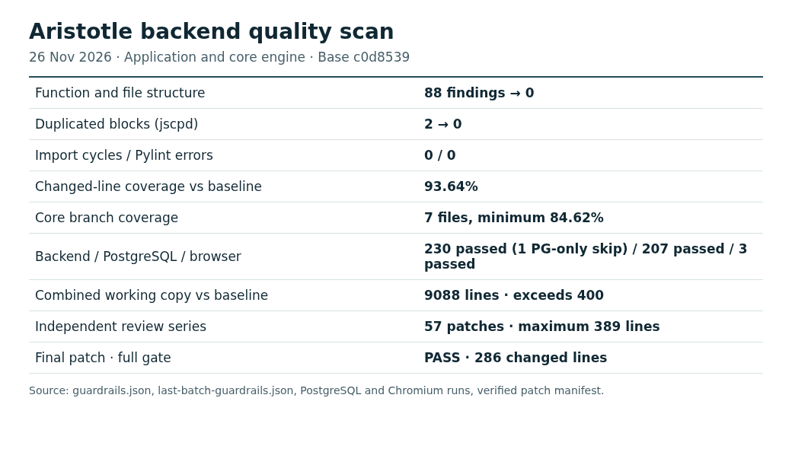
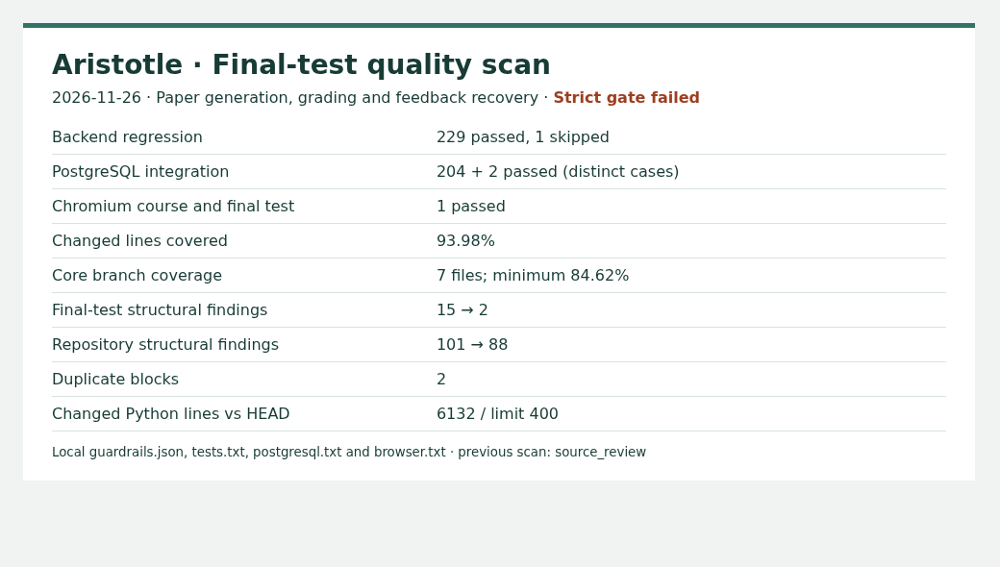
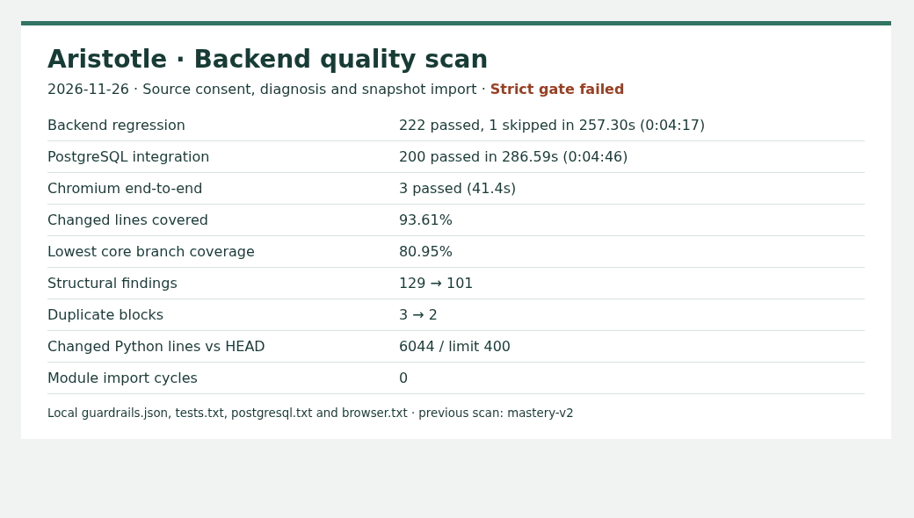
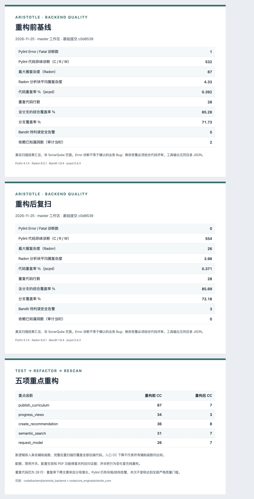
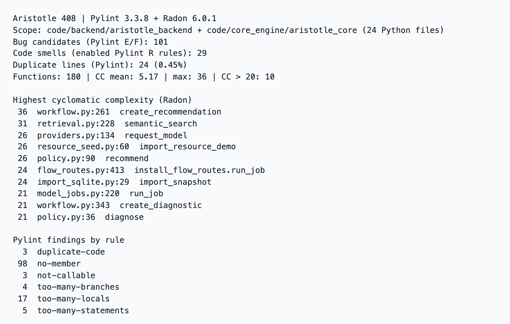
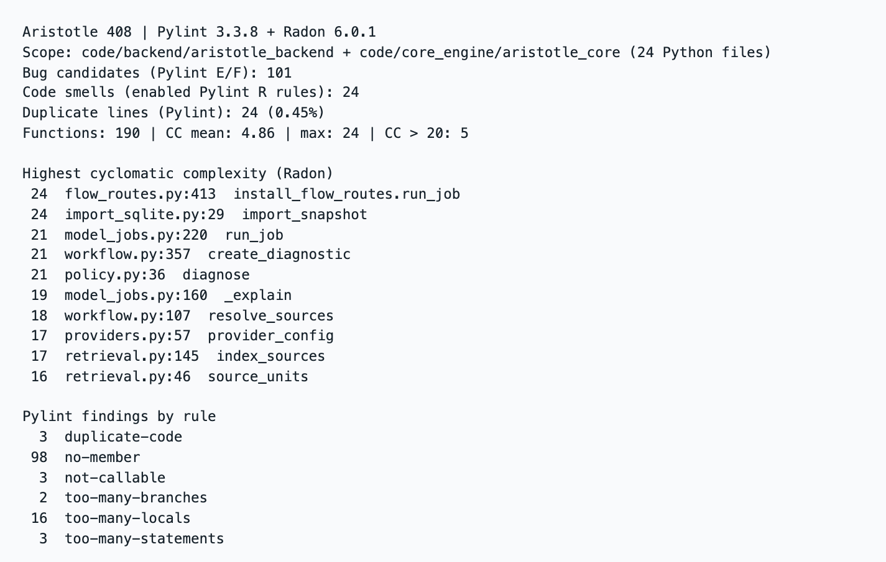

# 后端代码质量检查与重构报告

## SonarCloud 复核

交付提交 `850fc26` 的 GitHub Actions 前后端工作流均成功。独立 SonarCloud 检查中，新增代码安全性为 C、可靠性为 E，要求均为 A。安全告警涉及工作流依赖使用及评审基线的 Git 参数传递。可靠性发现中有 103 条来自对 PostgreSQL 升级快照运行 Oracle PL/SQL 长度规则。迁移证据现以 PostgreSQL 专用的 `.pgsql` 扩展名归档，升降级快照的既有字节摘要保持一致。实际迁移通过 Alembic 执行。另补齐扫描报告表头及截图工具的异步错误处理。[原检查](https://github.com/AbracaSora/Aristotle/runs/139727126028) · [升级快照](quality_evidence/strict_backend/postgres-upgrade.pgsql) · [降级快照](quality_evidence/strict_backend/postgres-downgrade.pgsql) · [原始摘要](quality_evidence/strict_backend/ddl-digests.json)

## 单提交发布核对

本次发布在远端 `feb760c` 的基础上整合课程扫描、同伴可复核的历史记录与六个新增回归用例。从该基线重新生成 57 个评审补丁，最大一批 389 行。提交钩子对真实父提交逐批重放并校验最终源码，完整覆盖率仍针对累计差异。已提交的版本可用 `uv run python scripts/check_guardrails.py --full --base HEAD^` 重验。[本次发布评审包](../../quality/backend-review.zip)

## 后端重构与分批评审（2026-11-26）

| 指标 | 上次完整扫描 | 当前工作区 |
|---|---:|---:|
| 后端及规则引擎结构超限 | 88 | 0 |
| 6 行及以上重复块（50 token 起） | 2 | 0 |
| 新增及修改的可执行行覆盖率 | 93.98% | 93.64% |
| 逐文件分支覆盖达标 | 7/7 | 7/7，最低 84.62% |
| 相对 `c0d8539` 累计 Python 增删行 | 6132 | 9088 |

整份 master 工作区的严格门禁仍因 TH-11（每批最多 400 行）返回失败。独立检出按依赖拆成 57 批，Git 增删数和护栏口径每批均通过，最大 389 行。每批均实际重放、编译且验证 Git tree，最终两个包内的全部 57 个 Python 文件与工作区逐字节一致。在独立检出另配同版测试与质量工具，将**最后一批**作为当前差异运行完整护栏，结果通过（286 行）。完整工作区的覆盖率以上表为准；各中间批次的检查范围见包内说明。[可重放补丁与清单](quality_evidence/strict_backend/backend-review.zip) · [全量报告](quality_evidence/strict_backend/guardrails.json) · [最后一批完整护栏](quality_evidence/strict_backend/last-batch-guardrails.json)

后端回归 230 项通过，默认数据库运行跳过 1 项 PostgreSQL 专用测试。独立 PostgreSQL 集成套件 207 项通过。Chromium 的课程订正与掌握、诊断与反馈、PDF 来源授权与撤回三条流程均通过。浏览器使用受控模型响应。编译、格式、类型、依赖审计均通过，Pylint 错误、模块导入环、中高安全告警和未处理密钥候选均为零。[测试](quality_evidence/strict_backend/tests.txt) · [PostgreSQL](quality_evidence/strict_backend/postgresql.txt) · [Chromium](quality_evidence/strict_backend/browser.txt) · [六个函数的前后指标及代码](quality_evidence/strict_backend/comparison.md)



### 历史复核记录

## 最终小测复核（2026-11-26）

本轮重点检查成绩保存、异步反馈与任务恢复。并行检查期间，旧护栏两次因测试子进程超出 300 秒而在写汇总前退出。护栏现保留该步骤的退出码 124 与部分输出，继续生成失败报告；失败步骤的旧扫描或覆盖文件不参与本次评定。保留原时限，9 项护栏单测均通过。[超时复核](quality_evidence/final_paper/guard-timeout.txt)

默认后端回归 **229 项通过，1 项 PostgreSQL 专用用例跳过**。真实 PostgreSQL 共通过 **206 项**，其中 204 项来自完整集成套件，随后新增的 2 个独立用例在同一版应用代码上补跑。Chromium 复跑了订正解锁至通过最终小测的学生流程。模型调用由本地替身响应。[后端日志](quality_evidence/final_paper/tests.txt) · [数据库日志](quality_evidence/final_paper/postgresql.txt) · [浏览器日志](quality_evidence/final_paper/browser.txt)

| 护栏检查 | 资料授权复核 | 最终小测复核 |
|---|---:|---:|
| 小测相关结构超限 | 15 | 2 |
| 全仓结构超限 | 101 | 88 |
| 重复块 | 2 | 2 |
| 累计 Python 变更行，门槛 400 | 6044 | 6132 |
| 新增／修改行覆盖率 | 93.61% | 93.98% |
| 列入逐文件分支门禁的核心文件 | 5 | 7 |

**严格门禁仍失败。** 创建试卷和提交试卷这两个 Python 函数各有 5 个形参，阈值为 4。两个重复块仍在历史迁移中。各核心文件的分支覆盖均达到 80%，最低为 84.62%。编译、格式、Ruff、类型、依赖审计均通过，Pylint Error/Fatal、未处理的密钥候选和中高安全告警均为零。[逐项扫描](quality_evidence/final_paper/guardrails.json) · [所有超限位置](quality_evidence/final_paper/findings.csv) · [重构前后对比](quality_evidence/final_paper/comparison.md)



## 上轮资料授权复核

2026-11-26，在 master 工作区 `c0d8539` 上复查了资料授权、诊断蓝图、证据计算与旧库导入。**完整回归通过，严格质量门禁仍失败。** 结构诊断由 129 条降至 101 条。工作区与 HEAD 的累计差异增至 6044 行，本次提交审查的规模仍需拆分。

| 检查 | 上轮 | 本轮 |
|---|---:|---:|
| 默认后端回归 | 219 通过、1 跳过 | 222 项通过、1 项跳过 |
| 真实 PostgreSQL 集成回归 | 197 通过 | 200 项通过 |
| Chromium 学生端流程 | 3 通过 | 3 项通过 |
| 新增／修改行覆盖率 | 93.27% | 93.61% |
| 五个核心文件的最低分支覆盖率 | 80.95% | 80.95% |
| 结构超限条数 | 129 | 101 |
| 重复块 | 3 | 2 |
| 累计 Python 变更行，门槛 400 | 4947 | 6044 |

默认后端测试跳过的 PostgreSQL schema 隔离用例已在独立数据库套件执行。前端另有 21 项单测通过，生产构建成功并提示部分包体积超过建议值。Ruff、格式、编译、mypy、依赖审计均通过，Pylint 的 Error/Fatal 为零。中高安全告警与未处理的密钥候选均为零。剩余两个重复块位于 Alembic 的 0001 和 0002 历史迁移。学生端验证使用临时 SQLite、自编 PDF 和进程内模型响应，PostgreSQL 另用独立测试库逐例创建 schema。[完整扫描](quality_evidence/source_review/guardrails.json) · [结构问题逐条位置](quality_evidence/source_review/findings.csv) · [后端日志](quality_evidence/source_review/tests.txt) · [PostgreSQL 日志](quality_evidence/source_review/postgresql.txt) · [浏览器日志](quality_evidence/source_review/browser.txt)



本轮先用测试复现三种撤回授权后仍继续发送正文的情况，再在索引、模型重试和结果落库三个位置校验来源。诊断蓝图、任务引用与迁移也分别重构。授权修复的关键代码、五个函数的前后指标与验证口径见[本轮重构对比](quality_evidence/source_review/comparison.md)。上轮订正解锁、推荐与上传的验证保存在 [mastery-v2 扫描](quality_evidence/mastery_v2/guardrails.json)。

以下第1–7节保留11月25日的基线与Top5重构对比，作为历史阶段证据，不替代上表的最新状态。旧阶段使用包名覆盖范围；最新改用源码路径，包含Alembic动态加载脚本，因此总覆盖率不可无说明地直接横比。历史“数据库不可连接”等状态已由11月26日真实验证取代。

## 1. 课程任务与范围

依据课程 [part3develop.md 的第 9 周实践任务](https://github.com/bettermorn/IntelligentSWEPractice/blob/main/courseware/pages/part3develop.md)、[CodeQualitySkill](https://github.com/bettermorn/ACMWDevHubPPT/blob/master/Methodology/CodeQualitySkill.md) 和 [CodeReviewTemplate](https://github.com/bettermorn/ACMWDevHubPPT/blob/master/Methodology/CodeReviewTemplate.md)。用户提供的 `/courseware/171`、`172` 页面读取为 404，因此核对了课程仓库中的原始课件，未据失效页面臆造任务。

| 课程要求 | 本次交付 |
| --- | --- |
| 至少一种静态分析工具 | Pylint 4.1.4；配套 Ruff、Radon、Bandit、jscpd、pip-audit |
| Bug / Code Smell / 圈复杂度 / 重复率 | 下表与原始 JSON；区分扫描诊断、确认缺陷和误报 |
| Top5，先测试后重构 | 重构前全量 109 项通过；五项高风险复杂流程的原函数、后函数、diff、回归证据 |
| 重构后复扫 | 相同源码范围、相同 Pylint 版本和 jscpd 参数；包含新增辅助函数 |
| 扫描报告截图 | 下方应用内浏览器实拍图，非绘制或模拟的 SonarQube 界面 |
| 代码评审 | [code_review.md](code_review.md)，标明 AI 自审、未关闭项和待人工确认事项 |

源码扫描范围：`code/backend/aristotle_backend`、`code/core_engine/aristotle_core`，包括迁移和种子工具；不把测试、前端或生成的 OpenAPI 算入后端圈复杂度。测试覆盖率范围相同。SQL、Vue、依赖漏洞和人工业务判断不是 Pylint 的替代指标。

## 2. 基线与方法

先保存重构前工作区副本及 [源码 SHA256 清单](quality_evidence/before/source_manifest.json)，再运行原有测试和扫描。本次基线已经包含此前尚未提交的 408 后端开发，**不是将 `git HEAD` 当作重构前全部源码**。五个原函数另保存为文本，保证进入仓库的交付包含可查看的重构前代码。

初扫使用 Pylint 3.3.9，依赖审计发现其已知漏洞后升级为 4.1.4，**重新扫描保留的原始源码**，用 4.1.4 的前后结果比较；初扫另存 `before/pylint-3.3.9-initial.json`，不混入比较。Pylint 的动态类型诊断在两版工具间也不同，不能把这部分变化计作修复收益。jscpd 固定为 5.4.3，`python / min-lines=6 / min-tokens=50`；没有为通过扫描关闭规则、忽略新文件或删除测试。

## 3. 扫描结果

| 指标 | 重构前 | 重构后 | 判读 |
| --- | ---: | ---: | --- |
| Pylint Error / Fatal | 1 | 0 | 原 `model_fields` 迭代被静态分析误判；改成显式公开字段白名单，不等于修复了一个运行时 Bug |
| Pylint C / R / W 诊断 | 532 | 554 | 结构类 R 从 103 降至 93；新增模块使文档/命名等 C 增至 436，W 为 25。告警总数并未下降 |
| 最大圈复杂度 | 87 | 26 | 全部扫描块，不只统计五个入口 |
| Radon 分析块平均圈复杂度 | 4.33 | 3.98 | 含类等 Radon 报告块；不冒充函数的平均复杂度 |
| 重复率 | 0.392% | 0.371% | 重复块仍为 3 块、28 行；比例降低主要因为源码分母增加 |
| 综合覆盖率（含分支） | 85.28% | 85.69% | pytest-cov，不是纯分支覆盖率 |
| 分支覆盖率 | 71.73% | 72.18% | 全后端仍未达到 80%；核心流程需继续逐文件评审 |
| Bandit 告警 | 5 | 3 | 去掉吞异常和动态 SQL 拼接；3 项保留判读见评审文档 |
| 审计当时的依赖已知漏洞 | 2 | 0 | 升级 Pylint 与 opentelemetry-api；不代表没有未知漏洞 |
| 后端测试 | 109 通过 / 1 跳过 | 121 通过 / 1 跳过 | 跳过的是 PostgreSQL 专用用例，不计为通过 |

完整数据：[前置扫描](quality_evidence/before/pylint.json)、[后置扫描](quality_evidence/after/pylint.json)、[全部诊断 CSV](quality_evidence/after/findings.csv)、[机器可读对比](quality_evidence/comparison.json)、[HTML 报告](quality_evidence/report.html)、[最终测试日志](quality_evidence/after/tests.txt)。

### 扫描报告截图

截图来自应用内浏览器打开本地报告，报告数值直接读取原始扫描 JSON。报告生成器、HTML、原始输出与截图一并保存。Chrome 独立 headless 启动受本机会话限制，故实际采用应用内浏览器截图。



## 4. 五项重点重构

按复杂度、调用频率、学生状态正确性与外部调用风险选择。它们是本次优先处理的五项，不声称是全库仅有的五个问题。每项都先使用已有保护测试通过基线，再进行重构并复跑；发现新增行为缺陷时另补先失败的回归用例。

| 项目 | 原因与重构 | CC 前 → 后 | 测试保护与源码证据 |
| --- | --- | --- | --- |
| Q01 课程发布 | 原函数混合层级、图、版本、题目校验与持久化；拆为 `curriculum_publication` 中独立校验与写入步骤，先校验全体后写入。PG 首次发布使用事务 advisory lock，避免配置行尚不存在时失去串行化 | 87 → 7 | `test_publication_rejects_invalid_content`、不可变题目/预设版本、活动小测不能换预设；[前后 diff](quality_evidence/publish_curriculum.diff) |
| Q02 进度计算 | 原函数加载用户全部 Attempt 和小测试卷，再按知识点重复筛选。按 question_key 聚合作答计数/正确数/时间，仅查询小测摘要列；拆开状态与先修解锁计算 | 34 → 3 | 错答也计完成、重复作答不增加完成题数、多个/空题先修、新版本不继承旧小测通过；[前后 diff](quality_evidence/progress_views.diff) |
| Q03 推荐编排 | 将诊断准入、近期错误与复习截止、应用需求和活动选择分离；保持 FR-5.3 原规则含义 | 36 → 8 | `test_design_flow.py` 全流程及 `test_policy.py` 规则测试；[前后 diff](quality_evidence/create_recommendation.diff) |
| Q04 语义检索 | 分离有效索引筛选、向量评分、混合排序和外传授权；模型调用后仍重新验证资料权限/hash，防止撤销后恢复私人资料 | 31 → 7 | 跨用户隔离、未授权不外传、模型更换、检索中撤销、无索引不伪装成关键词；[前后 diff](quality_evidence/semantic_search.diff) |
| Q05 模型调用 | 拆分配置生效、预留配额、响应信封、用量校验、有限响应读取及重试；错误落入持久化调用记录 | 26 → 7 | 重试/配额/异常格式用例；新配置、直接禁用、上海日期用例先失败后通过；[前后 diff](quality_evidence/request_model.diff) |

上述 CC 只描述被列函数；辅助函数和其他历史模块仍有超过 10 的函数，全部包含于 [后置 Radon 报告](quality_evidence/after/complexity.json)。不能通过把判断搬进辅助函数就宣称整个模块达标。

## 5. 与重构分开记录的功能修复

- **真实调用配置**：管理员 timeout/retries/total budget/标注日限额实际进入适配器，禁用开关在底层也生效。配额按 Asia/Shanghai 自然日统计，个人默认 100 次、标注全局默认 200 次，重试预留调用次数。未知 Token 继续保持未知。
- **标注输入**：加入知识点 ID、六类认知规则及独立规则版本；候选仍需人工审核，不允许模型直接发布或写学生能力结论。
- **PDF 文本导入**：真实字节抽取、页码保存、20 MB / 100 页边界、加密/无文本/损坏拒绝；不是 OCR。知识关联由可解释的名称匹配给出候选，必须学生确认。
- **小测反馈**：历史读取/模型错误有安全日志，失败保留规则建议和错误码；并发领取一次，中断反馈转 fallback，不自动重放可能已收费的请求；成绩先提交，反馈失败不能撤销判分。
- **模式与隐私**：公开题目使用明确字段白名单；数据库迁移检查使用 SQLAlchemy Table 查询；公开响应不带供应商密钥。

失败优先证据：[配置/禁用/日界线 3 项失败](quality_evidence/before/regressions.txt)、[原 PDF 占位导致 4 项失败](quality_evidence/before/pdf-regressions.txt)。修复后进入最终 121 项通过集合。新增反馈防重、PDF限制、排队过期和PDF异步返回测试也在最终日志内；后二者先失败证据见 `quality_evidence/remaining-regressions-before.txt`。

## 6. 复现与 CI

在仓库根目录执行，依赖版本以 `uv.lock` 和 `tools/quality/package-lock.json` 为准：

```bash
UV_CACHE_DIR=.local/uv-cache uv sync --locked --python 3.12
npm ci --prefix tools/quality --ignore-scripts --no-audit --no-fund
uv run python scripts/scan_quality.py --output .local/quality-current
uv run pip-audit --local --skip-editable -f json -o .local/quality-current/dependencies.json
uv run pytest -q --cov=aristotle_backend --cov=aristotle_core --cov-branch --cov-report=json:.local/quality-current/coverage.json --cov-report=term
uv run ruff check code/backend code/core_engine tests scripts
uv run ruff format --check code/backend code/core_engine tests scripts
```

`render_quality_report.py --date YYYY-MM-DD` 使用交付目录已有的 before/after JSON 生成表格与源码 diff。独立 Chrome 可启动的环境可运行 `node tools/quality/capture-report.cjs` 再次截图。不要覆盖原基线来制造更好看的对比。

CI 已加入扫描、依赖审计、综合覆盖率 80% 检查与报告 artifact；这不是 CodeQualitySkill 全部严格门槛的实现。此次未推送，**不能据配置文件声称远程 CI 已通过**。本地 Ruff、格式、编译检查通过；前端 20 项测试及生产构建通过，仍有包体积警告。

## 7. 数据库与未关闭事项

原项目已使用 PostgreSQL/pgvector，本次新增的是 `0003_curriculum_tests`，不是再次从零切换数据库。SQLite 路径的迁移、回滚保留数据和契约测试已通过；本轮 Docker daemon 不可连接，不能把 PostgreSQL 专用跳过项或历史 0002 验证算成本次通过。

数据库启动后执行 `uv run python scripts/verify_backend_upgrade.py`：先在独立测试数据库的随机 schema 中验证，全部通过后才迁移业务库，并逐表核对旧数据行数；不导入示例题、不重建业务库。成功后会生成 `postgresql-tests.txt` 与 `business-migration.json`。当前没有这两份成功证据。

| 未关闭项 | 状态与验收条件 |
| --- | --- |
| PostgreSQL 0003 迁移、真实并发/pgvector | 待本机服务可用后执行隔离测试与业务行数核对 |
| 严格复杂度、文件/函数长度、参数数与重复块门槛 | 未全部达到；按 code_review.md 的 SM-06/07 跟踪，不关闭规则绕过 |
| 核心分支覆盖率、类型分析、性能容量 | 综合覆盖率不能替代；需针对核心文件的缺失分支和性能样本继续验证 |
| 模型排队在内的 65 秒任务预算、PDF 接收后 2 秒状态返回及资源隔离 | 已加入排队在内的任务期限与先返回 queued 再抽取；网络流式阻塞、抽取性能与资源隔离要求仍缺运行验收，见 SM-08/09 |
| 内容与教育效果 | 408 演示资源仍须人工审核；100 题双评审、真实模型质量与教学效果没有据此自动验收 |
| 人工代码评审 | AI 已自审；真实评审者及评审时间未填写，不虚构组员意见 |

本报告可用于课堂检查真实代码质量和改进过程，不能作为正式发布已验收的证明。


---

# Aristotle 408 代码质量报告

2026-11-25 · 第 9 周开发实践

本次扫描覆盖后端 API、数据库迁移和学习规则引擎，共 24 个 Python 文件。按基线圈复杂度从高到低选择五个函数，先为它们补回归测试，再修改实现。前端另行运行类型检查、测试和生产构建。[课程任务](https://github.com/bettermorn/IntelligentSWEPractice/blob/HEAD/courseware/pages/part3develop.md#第9周实践任务) · [测试与扫描基线](https://github.com/AbracaSora/Aristotle/commit/5dcf79e) · [五项重构的代码差异](https://github.com/AbracaSora/Aristotle/commit/835374c)

## 两次扫描结果

| 指标 | 重构前 | 重构后 |
| --- | ---: | ---: |
| Bug 候选告警（Pylint E/F） | 101 | 101 |
| Code Smell（已启用的 Pylint R 类规则） | 29 | 24 |
| 函数最高圈复杂度 | 36 | 24 |
| 函数平均圈复杂度 | 5.17 | 4.86 |
| 圈复杂度大于 20 的函数 | 10 | 5 |
| 函数数（含方法和嵌套函数） | 180 | 190 |
| 重复代码行数及重复率 | 24 行，0.45% | 24 行，0.45% |

两次均使用 Python 3.12、Pylint 3.3.8 和 Radon 6.0.1。Pylint 统计重复代码、分支过多、局部变量过多、语句过多和嵌套过深五类坏味道。Radon 对每个函数单独计分，提取出的辅助函数也计入均值。[扫描配置](../../pyproject.toml) · [统计脚本](../../scripts/scan_course_quality.py)

**101 条 Bug 候选告警的复核。** 其中 98 条来自 Alembic 迁移代理的 14 个不同成员。核对已安装版本后，13 个成员可直接访问，另一个成员 `context.config` 在迁移上下文中可访问。另有 3 条指向 SQLAlchemy 的 `func.count`，在 SQLite 上实际执行 `select(func.count())` 返回了 1。本次在这些告警中确认的运行缺陷为 0。原始告警全部保留，便于检查者复核。

## 扫描报告截图

两图均为浏览器直接打开扫描器输出文本后的截图。文本版还包含每条 Pylint 告警的位置和原因。

**重构前** · [完整输出](quality/before.txt)



**重构后** · [完整输出](quality/after.txt)



## 五处重构前后对照

| 函数 | 复杂度 | 原实现 | 本次修改与验证 |
| --- | ---: | --- | --- |
| `workflow.create_recommendation` | 36 → 14 | 在同一函数内检查诊断资格、选择认知层级、回溯错题并创建任务。 | 拆出三项业务判断。已完成先修、理解证据充足时，显式请求理解题仍返回 3 道理解题。 |
| `retrieval.semantic_search` | 31 → 16 | 向量打分、授权复查和混合排序写在同一段流程中。 | 分离向量计算和结果排序。模型请求期间撤回授权的私人资料会从返回结果中消失。 |
| `providers.request_model` | 26 → 14 | 在重试循环内同时判断 HTTP 状态、解析响应、提取用量和记录结果。 | 提取响应校验，保留失败记账。允许重试一次时，连续 429 记录两次调用，403 只记录一次。 |
| `resource_seed.import_resource_demo` | 26 → 9 | 在一次长循环中写入题目、资料和章节，多次过滤知识点。 | 分开导入知识点内容和发布章节，按学科、章节预分组。第二个知识点缺题时，已处理的图和第一道题均回滚。 |
| `policy.recommend` | 26 → 14 | 给每个候选知识点排序时反复遍历题库和作答，同分时再查拓扑位置。 | 先按知识点和层级归集库存，再一次汇总最近作答时间。验证乱序重练记录下，未练题优先、已练题按最近练习时间升序排列。 |

逐项评审意见、对应测试和仍需关注的代码见[代码评审记录](code_review.md)。

## 回归结果与复现

| 检查 | 结果 |
| --- | --- |
| 原版后端测试 | 78 通过，1 项 PostgreSQL 专用测试在本地 SQLite 环境跳过 |
| 新增回归测试 | 6 个用例在重构前全部通过，重构后再次通过 |
| 重构后后端测试 | 本地 84 通过，1 项 PostgreSQL 专用测试跳过 |
| Ruff 检查与格式 | 均通过，检查 39 个 Python 文件的格式 |
| 前端类型、测试与构建 | 20 个测试通过，生产构建成功。Vite 提示主代码包超过 500 kB |
| PostgreSQL / pgvector | GitHub Actions 使用 PostgreSQL 17 和 pgvector 运行后端集成测试，检查通过。[运行记录](https://github.com/AbracaSora/Aristotle/actions/runs/45630380174) |

在仓库根目录执行下列命令。使用 `5dcf79e` 可复现重构前的业务代码，使用 `835374c` 可复现重构后。两个提交使用相同的扫描脚本和规则。

```sh
uv run --locked --python 3.12 --with pylint==3.3.8 --with radon==6.0.1 python scripts/scan_course_quality.py
uv run --locked pytest -q
uv run --locked ruff check code/backend code/core_engine tests scripts
uv run --locked ruff format --check code/backend code/core_engine tests scripts
```
