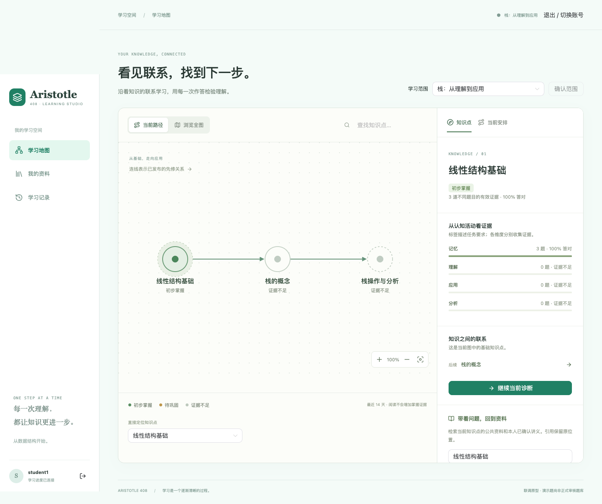

# 知识地图学习空间、语义检索与真实模型接入

更新：2026-11-08。本文说明本轮实现、使用方式与验证边界。学习内容仍为原有的少量自编演示内容，PDF 抽取及知识点候选关联仍保留 mock；不把界面或接口完成当作教学效果验证。

后续对照原始需求发现：真实模型配置与管理页面尚未统一，配额时区/数值、标注输入字段、整个任务的统一截止时间仍有偏差。本文的接口连通与样例验证不表示这些条目已满足；逐项证据见 [设计符合性检查](design_compliance_review_20261108.md)。

## 主学习界面

学生登录后进入“学习地图”。节点为已发布知识点，带箭头的边为已维护的先修关系；布局只读取这些关系，不用 embedding 相似度生成先修边。节点叠加当前学生的证据状态，当前任务另有目标标记。

支持全图/当前路径切换、搜索定位、拖动、按钮缩放、Ctrl/Command 滚轮缩放与键盘选择。小屏可聚焦单个知识点，通过关联按钮或知识点选择器导航。节点位置采用稳定的有向无环图分层布局，不随每次刷新重新随机排布。

点击节点后，侧栏提供记忆、理解、应用、分析的独立证据及先修情况。“当前安排”页签承接原有范围选择、分段诊断、任务接受/更换/跳过、资料复习、反馈和独立复测。地图改变显示与入口，不重写后端判分或把认知标签当成学生能力等级。地图目前使用原有版本化 JSON 知识图；稳定知识点/先修边的规范化关系表仍是后续工作。

## 来源与检索

- 公共资料来自 `learning_resources`；私人资料需属于当前用户、未删除且知识关联已确认。
- 阅读/关键词检索留在服务端；语义检索需发送本次查询到 embedding 服务，界面要求明确确认。
- 私人资料默认不允许模型处理。在“我的资料”逐份授权后，已确认片段才可参与外部 embedding 或解释；撤销关联、授权或删除会清理相关向量和已保存解释。
- 长文本以 1200 字符片段、150 字符重叠处理，保留原页码/段落和字符位置。每批最多 8 个片段，每次索引最多 200 个片段；过大范围明确失败。
- 索引同时记录来源身份、内容 hash、模型服务/模型/维度 namespace。文本改变或模型改变后，旧向量不能作为当前索引使用。
- PostgreSQL 使用 pgvector 的实际 `vector` 类型和 `<=>` 余弦距离运算；SQLite 的 JSON/本地余弦只供隔离测试。当前采用小库精确搜索，尚未建立近似索引或完成检索质量评测。
- 关键词、语义、混合三种模式明确区分；无服务、无有效索引或来源不可用时不把关键词结果伪装成语义命中。混合排序在向量候选中加入关键词权重，阈值仍是原型参数。

## 模型服务配置

根 `.env`（Git 忽略）中分别配置：

```dotenv
ARISTOTLE_LLM_BASE_URL=https://<workspace>.cn-beijing.maas.aliyuncs.com/compatible-mode/v1
ARISTOTLE_LLM_MODEL=qwen3.8-flash
ARISTOTLE_LLM_API_KEY=<仅在本地填写>
ARISTOTLE_EMBEDDING_BASE_URL=https://<workspace>.cn-beijing.maas.aliyuncs.com/compatible-mode/v1
ARISTOTLE_EMBEDDING_MODEL=qwen3.7-text-embedding-flash
ARISTOTLE_EMBEDDING_API_KEY=<仅在本地填写>
ARISTOTLE_EMBEDDING_DIMENSIONS=1024
ARISTOTLE_MODEL_TIMEOUT=30
ARISTOTLE_MODEL_RETRIES=0
ARISTOTLE_MODEL_DAILY_LIMIT=200
```

地址须为服务根路径，适配器追加 `/chat/completions` 或 `/embeddings`。通用兼容请求使用 `max_tokens`；供应商要求不同字段时可设 `ARISTOTLE_LLM_TOKEN_FIELD=max_completion_tokens`。维度配置用于校验返回长度，不擅自发送供应商未必支持的降维参数。换模型或修改已加载变量后重启后端。

必要时设置后端专用 `ARISTOTLE_MODEL_PROXY`；不改系统或 Git 代理。无鉴权的本地服务可显式设置对应 `ARISTOTLE_LLM_LOCAL=1` / `ARISTOTLE_EMBEDDING_LOCAL=1`，但私人资料的授权要求不变。前端仅获取就绪状态和模型名，不获取服务密钥。

适配器使用兼容协议的真实 HTTP 调用。返回结果经 Pydantic 与业务校验；错误响应和日志不回传鉴权头或原始私人输入。调用记录保留输入 hash、模型、namespace、状态、预留请求数、实际请求数、供应商返回的用量和耗时，不保存提示正文。配额在 PostgreSQL 事务锁下预留：全局默认为每日 200 次、每用户最多 60 次（UTC 日）；失败和重试预留仍占额度，重试默认关闭、上限 1 次。此配额是实现保护，不是供应商账单核对或费用承诺。

### 标注

维护者选择草稿/待审核题目，点击“请求真实模型标注”。完整题目版本、标准答案和解析送入模型，返回认知候选、理由、置信度和歧义；版本、枚举、字段及状态均校验。相同用户、内容、模型与提示版本的进行中任务合并；未审核的已完成候选可复用。

结果只进入待审核区，仍需人工核验答案、解析与最终标签才能发布。调用期间题目被发布/停用或账号权限改变时，不覆盖现有发布状态。模型置信度只供审核参考，不自动代表标注质量。

### 有来源的解释

学生选择最多 6 个来源并确认外传后请求解释，返回正文和可核对的来源引用。伪造来源 ID、跨账号来源、撤销授权的私人资料和无引用的肯定回答会被拒绝。对作答的辅助解释只在已有本人提交记录时附带题目、答案与判分；它不修改原判分或掌握证据。地图侧栏和已作答题目的折叠区都提供入口。

资料删除、撤销或关联改变会使引用它的旧解释不再展示；推理结束后再次检查来源及权限，防止较晚返回的请求恢复已撤销内容。真实性、支持度和教学适切性仍需独立评测。

## 任务运行与启动

模型任务保存在 `service_jobs`，真实任务类型为 `live_index`、`live_annotation`、`live_explanation`。通过行锁与条件更新领取一次，网络调用期间不持有领取锁。默认在响应后由本进程执行；任务持久化后也可由独立 worker 领取：

```bash
ARISTOTLE_INLINE_WORKER=0 uv run uvicorn aristotle_backend.app:create_app --factory --host 127.0.0.1 --port 8020
# 另一个终端
uv run python -m aristotle_backend.model_jobs
```

`--once` 只领取一项。进程中断超过 30 分钟的 running 任务标为失败，不自动重发可能已计费的请求。部署仍需补正式进程托管和监控；目前没有新增 Redis 或消息平台。

本轮迁移 `0002_semantic_learning` 新增 `source_embeddings`、`model_calls` 和资料外传授权字段，共 22 张业务表。Compose 使用带 pgvector 的 PostgreSQL 17 镜像，继续使用原有命名卷；不删除卷、不重复导入已经迁移的数据。

本机一条命令完成验证及启动：

```bash
uv run python scripts/run_learning_space.py --verify --probe-models
```

需要 Docker Desktop Engine 已启动。脚本依次启动数据库、应用迁移、执行 PostgreSQL 集成检查、安装锁定前端依赖、运行前端测试/构建及 Chrome E2E，再做 4 次真实模型探测，最后在 8020/5180 启动后端和前端。端口冲突会停止并提示，不杀掉旧进程。Ctrl-C 只关闭此脚本启动的子进程，数据库卷保留。

`--probe-models` 是显式的真实调用：仅用隔离测试 schema 中自编的公共材料，验证索引、语义查询、待审核候选与带引用解释，不发送业务库中的个人讲义；探测 schema 结束后清理。省略该选项可只做配置启动；省略 `--verify` 不运行完整测试；`--e2e` 只续跑 Chrome 浏览器检查，随后继续探测（若指定）和启动，不重复 PostgreSQL 测试或前端安装/构建。

日志与截图均留在忽略目录：`.local/backend.log`、`.local/frontend.log`、`.local/postgresql-verification.log`、`.local/learning-services-probe.json`、`.local/learning-space-status.json`、`.local/learning-map.png`。浏览器 E2E 使用独立 SQLite 夹具，不代表 PostgreSQL 的浏览器验收；真实 PostgreSQL 由单独集成测试与模型探测覆盖。

## 本轮验证边界

已完成：Python 77 项通过、1 项 PostgreSQL 专用隔离检查在 SQLite 环境跳过；前端 20 项通过及生产构建；真实服务最小探测返回 HTTP 200，embedding 为 1024 维、用量 24 tokens，生成探测返回有效认知候选、用量 628 tokens。探测使用自编内容且没有发布题目。

上述实际探测证明接口连通及输出可校验，不证明检索质量、标注准确率或学习效果。本机日志确认：已在原有数据卷应用 `0002_semantic_learning`，22 张业务表中原有业务行数未变；真实 PostgreSQL 集成测试 **66 passed, 1 warning in 28.46s**，含实际向量运算和 schema 隔离检查。警告为现有 TestClient 弃用提示。

浏览器首次运行暴露画布 SVG 样式覆盖工具栏图标的问题，续跑又暴露测试过早关闭下一段弹窗的时序问题；均已修正。最新 Chrome E2E **1 passed (6.1s)**，覆盖节点真实点击、缩放、范围选择、三题提交与反馈、进入下一段、Esc 关闭，以及 390px 手机宽度的节点操作。桌面和手机实际截图已人工查看。E2E 使用独立 SQLite 夹具；不把它描述成 PostgreSQL 全闭环浏览器验收。

真实 PostgreSQL + pgvector 与已配置模型的四调用探测全部成功：

| 调用 | 验证结果 | 供应商返回 total_tokens |
| --- | --- | --- |
| 公共资料 embedding | 索引 1 个自编来源片段 | 103 |
| 语义查询 embedding | 实际 `<=>` 运算返回 1 个来源，分数 0.53182 | 25 |
| 真实模型标注 | 返回有效候选，仍须人工审核且题目未发布 | 756 |
| 有来源解释 | 返回 1 个有效来源 ID 引用，学习证据前后不变 | 661 |

四次请求均为 succeeded，各请求实际调用一次，无重试，共 1545 tokens。仅使用独立测试 schema 中自编的公共内容，schema 已清理；不是对私人讲义的自动索引。引用 ID 校验通过不等于已评测语义支持度，单个样例的分数不代表检索质量。

常驻服务启动记录已核对：前端 `http://127.0.0.1:5180/`、后端 `http://127.0.0.1:8020`；实际 `/health` 返回 postgresql、revision `0002_semantic_learning`，前端代理认证边界验证通过。另在该 PostgreSQL 服务页面登录并选择“栈的概念”，确认迁移前的 6 道证据仍可读取，理解和应用各 3 题，记忆与分析仍显示证据不足。此页面核对只读取数据，未新增作答或模型调用。终端需保持打开；这些结果不等同于正式教学效果、负载或生产部署验收。



[手机宽度验收截图](../media/learning-map-mobile.png) 与桌面图均来自同次成功 E2E，不含业务库私人资料。

参考：[OpenAI Embeddings 请求格式](https://platform.openai.com/docs/api-reference/embeddings/create)、[OpenAI Chat 请求格式](https://platform.openai.com/docs/api-reference/chat/create)、[阿里云兼容 Chat](https://www.alibabacloud.com/help/en/model-studio/qwen-api-via-openai-chat-completions)、[阿里云 embedding 同步接口](https://help.aliyun.com/en/model-studio/text-embedding-synchronous-api)、[pgvector](https://github.com/pgvector/pgvector)。
